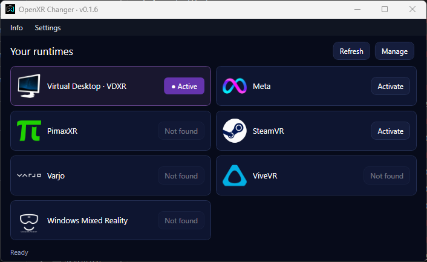

# OpenXR Changer

**A compact, portable OpenXR runtime switcher for Windows x64.**  
**Ein kompakter, portabler OpenXR-Runtime-Wechsler für Windows x64.**

[Download / Herunterladen](https://github.com/urscaviezel/OpenXR-Changer/releases/latest) · [Report an issue / Problem melden](https://github.com/urscaviezel/OpenXR-Changer/issues)

[English](#english) · [Deutsch](#deutsch)



## English

OpenXR Changer shows your installed OpenXR runtimes in a compact two-column view and lets you change the Windows system default. The active runtime is highlighted, and the window adjusts its height to the visible entries.

### Tray and quick switching

Right-click the tray icon to select a visible runtime. The current runtime has a small green dot and green highlighting; unavailable entries are disabled. Double-click opens the main window. **Settings → Tray** controls starting in the tray and keeping the app running when its window is closed. Choose **Exit** in the tray menu or under **Info** to quit completely.

**Settings → Switch without UAC → Set up / repair** optionally installs a dedicated Windows service after one administrator confirmation. It permits the configured Windows user to select local x64 runtime manifests while the app stays unelevated, including after reboot. Network paths and filesystem links are rejected. The service runs as LocalService with a service-specific registry permission; it does not execute runtime DLLs. If configured but unavailable, switching fails without falling back to a surprise UAC prompt. Use **Check connection** to verify it. Choose **Uninstall helper** in this dialog or remove **OpenXR Changer Runtime Helper** through Windows Apps to revoke the permission. The active runtime is preserved. The helper is separate from the per-user app and is not removed by uninstalling that app. The portable package also includes its installer, but using the helper adds this installed component to the machine. Changing the helper itself requires a fresh administrator confirmation.

Alternatively, **Settings → Restart as administrator** grants the whole app elevated rights for the current session only. Without either option, each switch requires the normal Windows approval. UAC remains enabled in every mode.

The optional **OpenXR-Changer-Setup-win-x64.exe** installs for the current Windows user, adds a Start menu entry and offers desktop and tray-autostart shortcuts. Autostart runs with normal permissions. Installation does not import a separate portable copy's settings automatically. Close the portable copy before starting the installed app. Uninstall asks whether to keep or remove settings, imported logos and language files; keeping them is the default. A running app, including tray mode, must be closed before anything is removed. Windows-managed application history/cache entries can remain.

### Download and start

1. Download **OpenXR-Changer-win-x64.zip** from the [latest release](https://github.com/urscaviezel/OpenXR-Changer/releases/latest).
2. Extract the **entire ZIP** into a writable folder.
3. Start **OpenXR-Changer.exe**.

No installer or separate .NET runtime is required. To move the app, move its entire folder, including `assets`, `lang` and the `portable` folder created on first use.

### Features

- Built-in entries for **Virtual Desktop (VDXR), SteamVR, Meta, PimaxXR, ViveVR, Windows Mixed Reality and Varjo**.
- Automatic detection through known installation locations, Windows registry entries and Steam libraries. Nonstandard locations can be added manually.
- Add custom runtimes and edit their name, manifest path and logo at any time.
- Show or hide entries through **Manage runtimes**. Missing presets are initially hidden.
- Compact dark interface, transparent runtime logos and automatic window heights.
- **English, German and French**, with immediate language switching. Extendable JSON translations in `lang`.
- Optional update checks at startup and a manual check under **Info**. Available updates are installed only after confirmation; downloads are verified against GitHub's SHA-256 digest.
- Settings and imported logos stay in the portable folder.

### Usage

Select **Activate** beside an installed runtime. Without the optional helper or administrator mode, Windows requests administrator approval. Restart running VR applications afterwards.

- **Settings → Language settings:** select the interface language; changes are saved immediately.
- **Settings → Manage runtimes:** add, edit, show or hide entries.
- **Settings → Check for updates at startup:** enable or disable automatic checks.
- **Info → About:** credits and the project link.

The app changes the **64-bit Windows system default** at `HKLM\SOFTWARE\Khronos\OpenXR\1\ActiveRuntime`. It does not modify the 32-bit setting. Games and `XR_RUNTIME_JSON` can override the system default. Runtime software must already be installed; this app does not install VR runtimes. Only known supported manifests are added automatically; an unlisted active runtime is shown generically.

### Portable data and translations

| Location | Contents |
| --- | --- |
| `portable/settings.json` | Language, update preferences and runtime entries |
| `portable/settings.json.bak` | Previous settings backup |
| `portable/logos/` | Imported custom logos |
| `lang/en.json`, `de.json`, `fr.json` | Interface translations |

To add a language, copy a JSON file, translate its values and save it as UTF-8 with a language-code filename, such as `it.json`. Reopen the language dialog to select it. Missing keys fall back to English.

Updates preserve portable data and existing language files. New built-in translation keys remain available even when your existing JSON files do not contain them. Known damaged default translations from early 0.1.8 test builds are corrected without replacing custom translations. Installed runtime paths still point to the software on the current PC; moving the app does not move the runtimes themselves.

### Build and checks

Requires Windows and the **.NET 10 SDK** for building only:

```powershell
.\build.ps1
```

The script produces a fresh self-contained x64 build and `artifacts/OpenXR-Changer-win-x64.zip`, excluding personal settings. A development build is also possible with `dotnet build -c Release`. To build the installer, install Inno Setup 6 and run `./build-installer.ps1`.

To run the included checks, supply an absolute report path in an existing directory:

```powershell
.\OpenXR-Changer.exe --self-test C:\Temp\openxr-checks.txt
```

The checks do not switch your runtime. Version 0.1.8 passed 27 app self-tests and 20 helper checks. Live helper communication and runtime selection without repeated UAC prompts were tested. Installer checks cover preserving/removing user data and blocking uninstall while the app is running.

## Deutsch

OpenXR Changer zeigt deine installierten OpenXR-Runtimes in einer kompakten zweispaltigen Ansicht und lässt dich den Windows-Systemstandard wechseln. Die aktive Runtime ist hervorgehoben, und die Fensterhöhe passt sich den sichtbaren Einträgen an.

### Tray und Schnellwechsel

Ein Rechtsklick auf das Tray-Symbol zeigt die eingeblendeten Runtimes. Die aktive Runtime hat einen kleinen grünen Punkt und ist grün hervorgehoben; nicht verfügbare Einträge sind deaktiviert. Ein Doppelklick öffnet das Hauptfenster. Unter **Settings → Tray** lässt sich einstellen, ob die App im Tray startet und beim Schliessen des Fensters weiterläuft. **Beenden** im Tray-Menü oder unter **Info** schliesst die App vollständig.

**Settings → Umschalten ohne UAC → Einrichten / reparieren** installiert optional nach einer Administrator-Bestätigung einen eigenen Windows-Dienst. Dieser erlaubt dem eingerichteten Windows-Benutzer die Auswahl lokaler x64-Runtime-Manifeste, auch nach einem Neustart. Die App bleibt ohne erhöhte Rechte. Netzwerkpfade und Dateisystem-Verknüpfungen werden abgewiesen. Der Dienst läuft als LocalService mit einer eigenen Registry-Berechtigung und führt keine Runtime-DLLs aus. Ist er eingerichtet, aber nicht erreichbar, wird der Wechsel ohne überraschende Ersatz-UAC-Abfrage abgebrochen. Mit **Verbindung prüfen** lässt sich der Dienst testen. Zum Widerrufen **Helper deinstallieren** im Dialog verwenden oder **OpenXR Changer Runtime Helper** über Windows Apps entfernen. Die aktive Runtime bleibt erhalten. Der Helfer ist unabhängig von der App und wird bei deren Deinstallation nicht automatisch entfernt. Auch das portable Paket enthält den Helfer-Installer; seine Nutzung ergänzt jedoch eine installierte Komponente auf dem Rechner. Eine Änderung des Helfers selbst erfordert erneut eine Administrator-Bestätigung.

Alternativ gibt **Settings → Als Administrator neu starten** der gesamten App erhöhte Rechte für die aktuelle Sitzung. Ohne diese beiden Optionen wird weiterhin jeder Wechsel über die normale Windows-Abfrage bestätigt. UAC bleibt in allen Varianten eingeschaltet.

Die optionale **OpenXR-Changer-Setup-win-x64.exe** installiert für den aktuellen Windows-Benutzer, legt einen Startmenü-Eintrag an und bietet Desktop-Verknüpfung und Tray-Autostart an. Der Autostart erfolgt mit normalen Rechten. Einstellungen einer separaten portablen Kopie werden nicht automatisch importiert. Vor dem Start der installierten App die portable Kopie beenden. Bei der Deinstallation kannst du Einstellungen, eigene Logos und Sprachdateien behalten oder entfernen; standardmässig bleiben sie erhalten. Eine laufende App muss zuerst vollständig beendet werden, auch im Tray-Modus. Von Windows verwaltete Verlaufs- und Cache-Einträge können zurückbleiben.

### Herunterladen und starten

1. **OpenXR-Changer-win-x64.zip** aus dem [aktuellen Release](https://github.com/urscaviezel/OpenXR-Changer/releases/latest) herunterladen.
2. Das **gesamte ZIP** in einen beschreibbaren Ordner entpacken.
3. **OpenXR-Changer.exe** starten.

Kein Installer und keine separate .NET-Installation erforderlich. Zum Verschieben der App den ganzen Ordner mitnehmen, einschliesslich `assets`, `lang` und des beim ersten Start angelegten Ordners `portable`.

### Funktionen

- Vorgaben für **Virtual Desktop (VDXR), SteamVR, Meta, PimaxXR, ViveVR, Windows Mixed Reality und Varjo**.
- Automatische Erkennung über bekannte Installationsorte, Windows-Registry und Steam-Bibliotheken. Abweichende Pfade können manuell ergänzt werden.
- Eigene Runtimes hinzufügen und Namen, Manifestpfad und Logo jederzeit bearbeiten.
- Einträge über **Runtimes verwalten** ein- und ausblenden. Nicht gefundene Vorgaben sind zunächst ausgeblendet.
- Kompakte dunkle Oberfläche, transparente Logos und automatische Fensterhöhen.
- **Deutsch, Englisch und Französisch**, sofort umschaltbar. Erweiterbare JSON-Sprachdateien im Ordner `lang`.
- Optionale Update-Prüfung beim Start sowie manuell unter **Info**. Verfügbare Updates werden erst nach Bestätigung installiert; Downloads werden anhand des SHA-256-Prüfwerts von GitHub geprüft.
- Einstellungen und importierte Logos bleiben im portablen Ordner.

### Bedienung

Neben einer installierten Runtime **Aktivieren** wählen. Ohne Helferdienst oder Administrator-Modus fragt Windows für den Wechsel nach Administratorrechten. Laufende VR-Anwendungen danach neu starten.

- **Settings → Spracheinstellung:** Sprache auswählen; Änderungen werden sofort gespeichert.
- **Settings → Runtimes verwalten:** Einträge hinzufügen, bearbeiten, ein- oder ausblenden.
- **Settings → Beim Start nach Updates suchen:** automatische Prüfung aktivieren oder deaktivieren.
- **Info → Über OpenXR Changer:** Credits und Projektlink.

Die App ändert den **64-Bit-Windows-Systemstandard** unter `HKLM\SOFTWARE\Khronos\OpenXR\1\ActiveRuntime`. Die 32-Bit-Einstellung bleibt unverändert. Spiele und `XR_RUNTIME_JSON` können den Systemstandard übersteuern. Die Runtime-Software muss bereits installiert sein; diese App installiert keine VR-Runtimes. Automatisch übernommen werden nur bekannte unterstützte Manifeste. Eine nicht gelistete aktive Runtime wird neutral angezeigt.

### Portable Daten und Sprachen

| Speicherort | Inhalt |
| --- | --- |
| `portable/settings.json` | Sprache, Update-Einstellung und Runtime-Einträge |
| `portable/settings.json.bak` | Sicherung des vorherigen Einstellungsstands |
| `portable/logos/` | Importierte eigene Logos |
| `lang/en.json`, `de.json`, `fr.json` | Übersetzungen der Oberfläche |

Für eine weitere Sprache eine JSON-Datei kopieren, die Werte übersetzen und als UTF-8 mit einem Sprachkürzel als Dateiname speichern, zum Beispiel `it.json`. Den Sprachdialog erneut öffnen, um sie auszuwählen. Fehlende Texte werden auf Englisch angezeigt.

Updates behalten portable Daten und vorhandene Sprachdateien bei. Neue integrierte Übersetzungsschlüssel bleiben auch bei älteren Sprachdateien verfügbar. Bekannte beschädigte Standardtexte aus frühen 0.1.8-Testversionen werden gezielt korrigiert. Installierte Runtime-Pfade verweisen weiterhin auf die Software auf dem jeweiligen PC; beim Verschieben der App werden die Runtimes selbst nicht mitverschoben.

### Bauen und prüfen

Zum Bauen werden Windows und das **.NET 10 SDK** benötigt:

```powershell
.\build.ps1
```

Das Skript erstellt einen eigenständig lauffähigen x64-Build und `artifacts/OpenXR-Changer-win-x64.zip` ohne persönliche Einstellungen. Ein Entwicklungsbuild ist mit `dotnet build -c Release` möglich. Für ZIP inklusive Helper und den Installer Inno Setup 6 installieren und `./build-installer.ps1` ausführen.

Die integrierten Prüfungen benötigen einen absoluten Berichtspfad in einem vorhandenen Ordner:

```powershell
.\OpenXR-Changer.exe --self-test C:\Temp\openxr-checks.txt
```

Die Prüfungen wechseln keine Runtime. Version 0.1.8 hat 27 App-Selbsttests und 20 Helfer-Prüfungen bestanden. Die echte Helfer-Verbindung und Runtime-Wechsel ohne wiederholte UAC-Abfrage wurden getestet. Installer-Tests decken das Behalten und Entfernen von Benutzerdaten sowie die Sperre bei laufender App ab.

## Credits / Lizenz

Created by / Erstellt von **Urs Caviezel**.

Based on / Basierend auf [OpenXR Runtime Switcher by WaGi-Coding](https://github.com/WaGi-Coding/OpenXR-Runtime-Switcher). Original runtime-detection credits / Ursprüngliche Runtime-Erkennung: **KOGA Mitsuhiro**.

MIT license / MIT-Lizenz: [LICENSE.txt](LICENSE.txt).

Product names and logos belong to their respective owners. Some logo assets were prepared with AI-assisted background removal. / Produktnamen und Logos gehören ihren jeweiligen Rechteinhabern. Einige Logos wurden mit KI-Unterstützung freigestellt.


First start: the Windows display language selects German, French or English; unsupported languages fall back to English. Saved language choices are kept.

Erster Start: Die Windows-Anzeigesprache bestimmt Deutsch, Französisch oder Englisch; bei anderen Sprachen wird Englisch verwendet. Gespeicherte Sprachwahlen bleiben erhalten.
